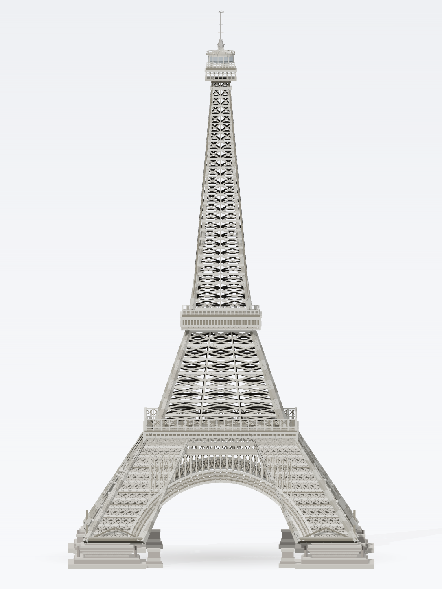

# 巴黎铁塔 · 程序化 Three.js 资产

**Procedural, animation-ready Eiffel Tower rebuilt from a single reference image as modular Three.js code.**



从一张参考图重建的**可编辑、可动画、可复现**的程序化巴黎铁塔资产：TypeScript + 原生 Three.js，
**没有贴图、没有下载的模型、没有 GLB、没有摄影测量** —— 几何全部由参数化代码生成。

A modular, animation-ready Eiffel Tower rebuilt from one reference image as **pure procedural
Three.js TypeScript**. No textures, no downloaded meshes, no GLB, no photogrammetry — every vertex is
generated by parameterised code.

---

## 特性 / Highlights

| | |
|---|---|
| 纯程序化 | 178,240 triangles · 43 named meshes · 89 named nodes · **0 texture maps** |
| 规格化构件 | 10 macro + 26 meso + 7 micro components（`spec/object-sculpt-spec.json`，严格校验通过） |
| 尺度真实 | 米制、Y-up、+Z 局部前向、语义底座 `y = 0`、总高 **330.33 m**、底座跨 **183.8 m** |
| 确定性 | 无 `Math.random()`，每次构建几何完全一致 |
| 运行时可操作 | `nodes / sockets / colliders / destructionGroups / semanticRegions` + `root.userData.sculptRuntime` |
| 可复现截图 | `?capture=1` 正交参考相机，按参考轮廓投影拟合（94.75% 画面高度） |
| 门禁验证 | silhouette **IoU 0.8996** · scale Δ **0.0065** · 构件覆盖 **0 错误 / 0 警告** |

## 快速开始 / Quick start

```bash
npm install
npm run dev        # http://127.0.0.1:4319/
npm run typecheck  # tsc --noEmit
npm run build      # typecheck + vite build
```

浏览器打开 <http://127.0.0.1:4319/>，鼠标左键旋转 / 滚轮缩放 / 右键平移（OrbitControls）。

### URL 参数 / Debug URL params

| 参数 | 作用 |
|---|---|
| `?capture=1` | 确定性截图模式（关闭交互、固定参考相机、DPR=1） |
| `?view=no-floor` | 隐藏影棚地面与阴影，便于轮廓检查 |
| `?view=sun-only` | 只保留主光 |
| `?exposure=0.9` | 覆盖 ACES 曝光 |
| `?asset=eiffel-tower` | 只显示指定资产（注册表模式） |

## 程序化 API / Programmatic use

```ts
import * as THREE from 'three';
import { createEiffelTower } from './src/assets/eiffel/eiffelTowerAsset';

// Full runtime contract (registry-ready)
const result = createEiffelTower();
scene.add(result.root);

result.root.name;               // 'eiffel-tower'
result.bounds;                  // THREE.Box3, metres, base at y=0
Object.keys(result.nodes);      // 89 named nodes (component ids + sockets)
result.sockets;                 // 4 sockets (platform 1/2/3 + antenna tip)
result.colliders;               // 10 box colliders
result.semanticRegions;         // legs / platforms / arches / shafts / cupola / antenna
result.root.userData.sculptRuntime; // action-ready runtime payload
```

```ts
import { createEiffelTowerModel } from './src/assets/eiffel/createEiffelTower';

// Bare group, no registry wrapper
const group: THREE.Group = createEiffelTowerModel();
scene.add(group);
```

The asset uses the `AssetFactoryResult` contract from `src/scene/assetRegistry.ts`, so it can be
registered alongside other assets:

```ts
registry.register('eiffel-tower', createEiffelTower);
const result = await registry.create('eiffel-tower');
```

## 工程结构 / Project layout

```
src/
├─ assets/eiffel/
│  ├─ kit.ts               # triangle accumulator: oriented beams, cylinders, revolves,
│  │                       #   arc ribs, lattice faces, per-vertex colours
│  ├─ common.ts            # measured dimensions (DIM), materials, profile/curve helpers
│  ├─ base.ts              # foundation plinths, four lattice legs, decorative arch bands
│  ├─ body.ts              # platform 1 + gallery, mid shaft, platform 2, upper shaft
│  ├─ top.ts               # platform 3, glazed cupola + ribbed dome, antenna and finial star
│  ├─ createEiffelTower.ts # assembly into the named component tree
│  └─ eiffelTowerAsset.ts  # AssetFactoryResult adapter (nodes/sockets/colliders/bounds)
├─ scene/                  # asset registry, studio scene, camera, lights, framing solver
├─ runtime/                # capture API, camera persistence, debug views, error overlay
└─ main.ts                 # bootstrap
spec/object-sculpt-spec.json  # 44-component ObjectSculptSpec (strict-quality pass)
docs/                     # architecture, validation, pipeline
screenshots/              # renders produced by this repository
```

## 主要尺寸 / Key dimensions (metres)

| 构件 | 范围 (y) | 外接半宽 |
|---|---|---|
| 石墩基座 (foundation plinths) | 0 – 15 | 23.5 |
| 四条桁架腿 (base legs) | 15 – 80 | 81.25 → 41.0 |
| 一层平台 (platform 1 + gallery) | 66 – 87.2 | 45.8 |
| 中段桁架 (mid shaft) | 80.2 – 138.2 | 37.9 → 18.9 |
| 二层平台 (platform 2) | 138.2 – 151.2 | 23.6 |
| 上段桁架 (upper shaft, concave) | 151.2 – 289 | 17.9 → 5.6 |
| 三层平台 (platform 3) | 289 – 300.8 | 8.9 |
| 玻璃灯笼 + 穹顶 (lantern/cupola) | 298.2 – 308.6 | 7.4 / 8.2 |
| 天线与星形尖顶 (antenna/spire) | 308.4 – 330.33 | 1.4 |
| 装饰拱 (decorative arches) | 12 – 65.8 | 拱心 49.6 / 拱带外缘 56.8 |

## 如何构建的 / How it was built

1. **测量**：从参考图提取轮廓半宽-高度曲线、三层平台带、桁架节距（上段 34 px / 中段 52 px）、
   拱线圆心与半径、调色（albumed `#DEDCD8`、缝隙 `#2E2A26`），换算 0.2407 m/px。
2. **门禁流水线**：使用 [media2threejs](https://github.com/promptwhisper/media2threejs) skill 的
   `image-object` 路由：assessment → spec → blockout → structural → form → material → interaction →
   optimization → turntable/多角度评审 → integration → handoff，全部状态机步骤带证据落地。
3. **几何**：参数化剖面（腿外缘线性、上段凹形站点）、X 撑 + 水平弦杆的桁架面、双面材质让镂空
   内部读成阴影、按实测节距生成每层构件。
4. **相机**：正交相机 + 4° 俯角，投影包围盒拟合参考轮廓（画面高 94.75% vs 目标 94.82%）。

## 验证 / Validation

| Gate | Result |
|---|---|
| `validate_sculpt_spec.py --strict-quality` | PASS（0 errors / 0 warnings） |
| `check_part_coverage.py`（真实模型 dump vs spec） | PASS：43 specified / 85 built / **0 errors, 0 warnings** |
| Tier-1 `diagnose_render.py` | PASS：silhouette **IoU 0.8996**（阈值 0.85）、scale Δ **0.0065**（阈值 0.08） |
| `divine_eye.py` | 硬门禁无失败；soft fidelity 0.8475（目标 0.85） |
| 多角度 `diagnose_render_multi_angle.py` | 无退化视角（hero / ±35° / profile / rear） |
| Playwright 截图 | 7/7，0 console/page errors |
| `tsc --noEmit` + `vite build` | 通过（CI 也在跑） |

详细数字与语义解释见 [docs/VALIDATION.md](docs/VALIDATION.md)。

## 已知局限 / Known limitations

- **单视图推断**：参考图是正面立视图，背面/侧面/挑台底部为按四重对称推断，不是实测。
- **底部略宽**：基座锥段比精测轮廓约宽 2–3.5% 画面高度。
- **桁架缝隙偏亮**：深层阴影/环境光遮蔽比参考图弱，暗部占比 ~14% vs 参考 24%。
- **不是数字孪生**：这是可编辑的程序化重建，而非 NeRF / 摄影测量还原；几何拓扑为艺术化近似，
  并非可直接施工的工程图纸。

## 许可与致谢 / License & attribution

- 本仓库代码与规格：**MIT**（见 [LICENSE](LICENSE)）。
- 构建流程使用了 [media2threejs](https://github.com/promptwhisper/media2threejs)（Apache-2.0）
  的规范与门禁工具；该 skill **未**打包进本仓库，仅作为开发依赖与致谢列名（见 [NOTICE.md](NOTICE.md)）。
- 参考照片为用户提供的素材，**未**随本仓库分发；仓库中的 `screenshots/` 均为本项目程序化渲染结果。
